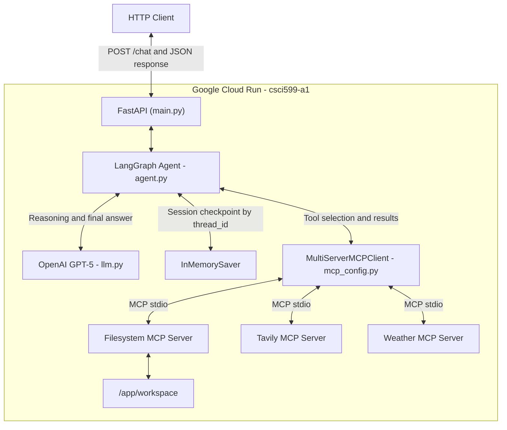
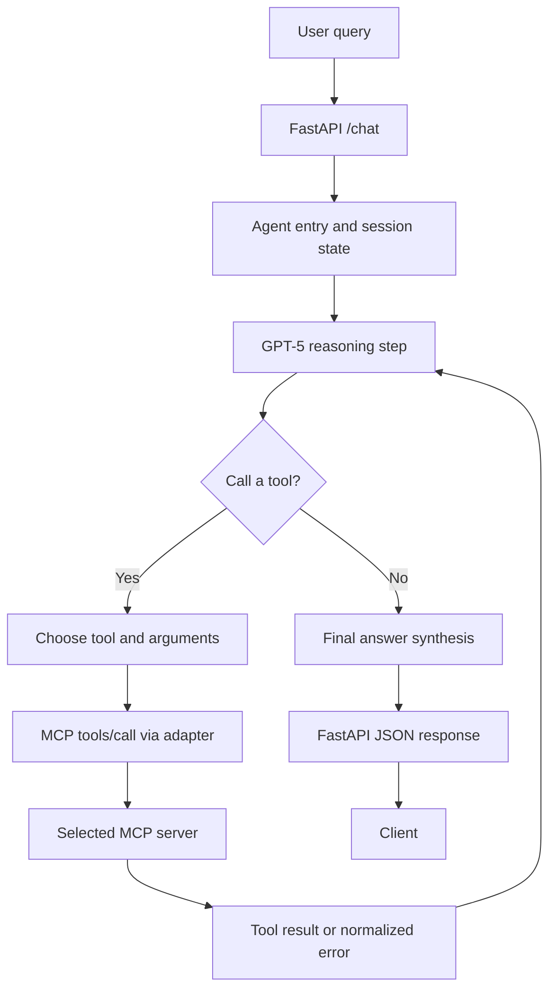
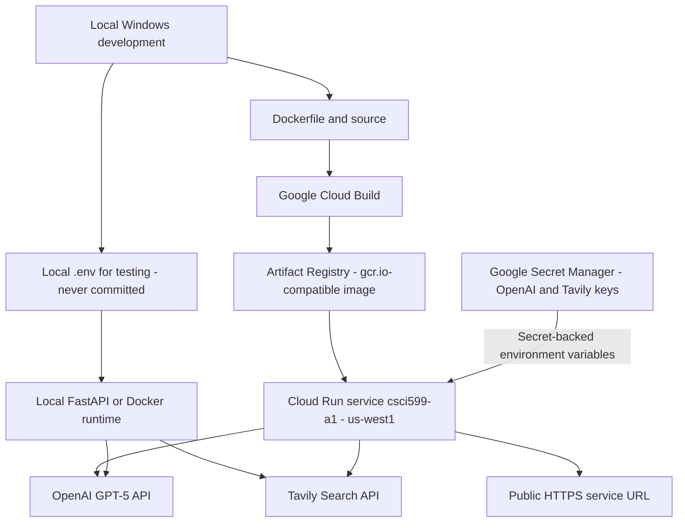

# CSCI 599 Assignment 1 — LangGraph Agent with MCP Tools

A containerized, stateful AI agent built with **LangGraph, FastAPI, OpenAI GPT-5, and Model Context Protocol (MCP)**. The agent selects tools exposed by three independently launched MCP servers—Filesystem, Tavily Search, and Weather—and is deployed as an HTTP service on **Google Cloud Run**.

> **Live Cloud Run URL:** https://csci599-a1-b7rvvpibna-uw.a.run.app  

## 1. System architecture



FastAPI accepts `query` and `session_id`. The agent uses `session_id` as the LangGraph `thread_id`, allowing follow-up turns to share conversation history while the Cloud Run instance remains alive.

## 2. Tool invocation and reasoning loop



After a tool response, control returns to GPT-5: the agent can reason over a tool result, invoke another tool, or finish with an answer. Tools are discovered through the MCP client rather than replaced by hard-coded responses.

## 3. Deployment topology



The deployed configuration uses **Secret Manager**, rather than embedding credentials in the Docker image or source repository. Local development uses `.env`, while Cloud Run receives its API credentials as secret-backed environment variables.

## 4. Technology stack

| Layer | Implementation |
|---|---|
| Language | Python 3.13 |
| HTTP API | FastAPI and Uvicorn |
| Agent | LangGraph / LangChain |
| LLM | OpenAI GPT-5 |
| MCP adapter | `langchain-mcp-adapters` / `MultiServerMCPClient` |
| MCP transport | stdio |
| Filesystem server | `@modelcontextprotocol/server-filesystem` |
| Search server | `tavily-mcp` |
| Weather server | `mcp_weather_server` |
| Checkpointer | LangGraph `InMemorySaver` |
| Testing | pytest |
| Packaging | Multi-stage Docker build |
| Hosting | Google Cloud Run |
| Secrets | Google Secret Manager |

## 5. MCP servers

**Filesystem MCP:** Provides tools for listing, reading, and writing files in the permitted `/app/workspace` directory. The server is started with `npx` and a workspace-root argument. The deployed agent has successfully listed, created, and read files through MCP. Container filesystem changes are ephemeral.

**Tavily MCP:** Provides search tools for external information. Requires `TAVILY_API_KEY`. A deployed `tavily_search` call was confirmed in Cloud Run logs.

**Weather MCP:** Provides weather and related utilities. The deployed `get_current_weather` call was confirmed in Cloud Run logs.

Weather MCP adds structured, location-specific weather data alongside general web search and file operations. It lets the agent answer weather questions directly and combine current conditions with research or saved notes when a request needs multiple tools.

The three servers are launched through the MCP client and use real protocol discovery and invocation (`tools/list`, `tools/call`).

### External MCP server attribution

- Filesystem server: https://github.com/modelcontextprotocol/servers/tree/main/src/filesystem
- Tavily MCP server: https://github.com/tavily-ai/tavily-mcp
- Weather MCP package: [`mcp_weather_server` on PyPI](https://pypi.org/project/mcp-weather-server/).

These are third-party MCP server implementations integrated into this project; they were not reimplemented here.

## 6. Project layout

```text
.
├── main.py
├── agent.py
├── llm.py
├── mcp_config.py
├── requirements.txt
├── Dockerfile
├── .dockerignore
├── .gitignore
├── .env.example
├── README.md
├── PROCESS_LOG.md
├── deploy.sh
├── tests/
│   ├── test_main.py
│   └── test_mcp_config.py
└── workspace/
```

## 7. Environment configuration

Create a local `.env` from `.env.example` and provide your own values:

```dotenv
OPENAI_API_KEY=replace_with_your_key
TAVILY_API_KEY=replace_with_your_key
DEBUG_TOOL_OUTPUT=false
```

Keep `.env` out of version control and avoid logging API credentials. In Cloud Run, the two API keys are supplied from Secret Manager secrets named `openai-api-key` and `tavily-api-key`.

## 8. Local setup and execution

Prerequisites: Python 3.13, Node.js/npm, working `npx`, and valid OpenAI and Tavily credentials.

```powershell
python -m venv venv
.\venv\Scripts\Activate.ps1
python -m pip install -r requirements.txt
python -m pip install pytest
uvicorn main:app --reload --host 127.0.0.1 --port 8000
```

API docs: http://127.0.0.1:8000/docs

### Example API request

```powershell
$body = @{
    query = 'Explain MCP in two sentences.'
    session_id = 'example-session'
} | ConvertTo-Json

Invoke-RestMethod `
    -Uri 'http://127.0.0.1:8000/chat' `
    -Method Post `
    -ContentType 'application/json' `
    -Body $body
```

**Request:**

```json
{"query":"Explain MCP in two sentences.","session_id":"example-session"}
```

**Response shape:**

```json
{"response":"Agent-generated answer"}
```

Use the same `session_id` for related turns and a different one for a separate conversation.

## 9. Memory and error handling

`InMemorySaver` stores LangGraph checkpoints by `thread_id`, derived from `session_id`. Memory was verified using two deployed `/chat` requests with the same session: the agent remembered a value supplied in the earlier request.

**Limit:** Memory is process-local and can be lost when Cloud Run scales to zero, restarts, or replaces the instance. The deployed service uses a maximum of one instance, but that does **not** make the checkpoint store durable.

The application includes Pydantic request validation, response extraction, agent-unavailable handling, MCP execution interception, and tool logging. Invalid request bodies can produce HTTP 422; unavailable/failed agent execution can produce HTTP 503. The `DEBUG_TOOL_OUTPUT` flag controls verbose tool output logging.

## 10. Automated and live verification

Run the local automated suite:

```powershell
python -m pytest tests/ -v
```

**Local automated test result:** 26 tests passed. These tests exercise validation, response extraction, API behavior, MCP handling, sequential tool calls, and session isolation using mocked components; they do not by themselves prove live MCP invocation or GPT-5's tool choices. The suite disables `.env` loading, replaces the LLM with an offline model, and blocks external socket connections.

**Separately verified on deployed Cloud Run:**

| Check | Result |
|---|---|
| Public `/chat` request using GPT-5 | Passed |
| Filesystem MCP directory listing | Passed |
| Filesystem MCP create and read file | Passed |
| Weather MCP tool invocation | Passed |
| Tavily MCP search invocation | Passed |
| Memory across two requests with the same session | Passed |
| MCP invocation evidence in Cloud Run logs | Passed |

The logs identified `list_directory`, `get_current_weather`, and `tavily_search` tool calls with successful results. 

## 11. Docker

The Dockerfile uses a multi-stage Python 3.13 slim build, installs Node.js/npm for the Node-based MCP servers, and runs the application under a non-root user.

```powershell
docker build -t csci599-agent:latest .

docker run --rm `
    --name csci599-agent `
    -p 8000:8080 `
    --env-file .env `
    csci599-agent:latest
```

The container listens on port 8080 internally. The example maps it to port 8000 on the host; use `http://127.0.0.1:8000/chat` to test it. The image was successfully built and started during development.

## 12. Google Cloud Run deployment

The application has been deployed to:

- **Project:** `csci599-mcp-agent-2026`
- **Service:** `csci599-a1`
- **Region:** `us-west1`
- **Ingress:** Public HTTP endpoint (`--allow-unauthenticated`)
- **Scaling:** Minimum 0 instances, maximum 1 instance
- **Memory:** 1 GiB
- **Concurrency:** 1
- **Request timeout:** 300 seconds
- **Credentials:** Google Secret Manager secrets injected into runtime environment variables

To retrieve the verified service URL:

```powershell
gcloud run services describe csci599-a1 `
    --project=csci599-mcp-agent-2026 `
    --region=us-west1 `
    --format='value(status.url)'
```

To test it without changing the deployment:

```powershell
$URL = gcloud run services describe csci599-a1 `
    --project=csci599-mcp-agent-2026 `
    --region=us-west1 `
    --format='value(status.url)'

$body = @{ query = 'Explain MCP in one sentence.'; session_id = 'readme-smoke-test' } | ConvertTo-Json
(Invoke-RestMethod -Uri "$URL/chat" -Method Post -ContentType 'application/json' -Body $body).response
```

### Deployment script

The `deploy.sh` script builds and publishes the Docker image using Google Cloud Build, then deploys the application to Google Cloud Run. API credentials are supplied through Google Secret Manager.

Run the script from the project root using Bash (for example, Git Bash on Windows):

```bash
bash deploy.sh
```

The script targets the `csci599-mcp-agent-2026` project in the `us-west1` region and requires authenticated `gcloud` access and existing Secret Manager secrets.

### Deployment procedure

1. Authenticate `gcloud`, select the correct project, and enable the required Google Cloud services.
2. Build the multi-stage Docker image and publish it to the project's Artifact Registry / gcr.io-compatible repository using Cloud Build.
3. Configure the dedicated Cloud Run runtime service account and grant only the required Secret Manager access.
4. Deploy the image to `csci599-a1` in `us-west1`, allowing unauthenticated requests, with `--min-instances=0` and `--max-instances=1`.
5. Inject `OPENAI_API_KEY` and `TAVILY_API_KEY` from Secret Manager; do not pass literal credentials in commands or source code.
6. Verify `/chat`, MCP tools, and memory through the public URL, then inspect Cloud Run logs.

The deployment uses Cloud Build, Artifact Registry, Cloud Run, and Secret Manager.

## 13. Cost and security notes

OpenAI GPT-5 requests incur token costs. Tavily searches may consume paid credits. Cloud Build, Artifact Registry, Secret Manager, and Cloud Run may also incur charges. A billing alert is not a hard spending cap. This deployment minimizes idle compute cost using scale-to-zero and limits instance count to one.

Avoid logging sensitive headers or secrets. Rotate credentials if exposed, then publish updated Secret Manager versions. Files written to `/app/workspace` on Cloud Run are ephemeral and not suitable for persistent storage.

## 14. Limitations and future work

- Process-local memory does not survive instance replacement.
- Cloud Run filesystem writes are ephemeral.
- Additional end-to-end and failure-injection tests would improve coverage.
- A persistent checkpointer and durable file storage would be needed for production use.
